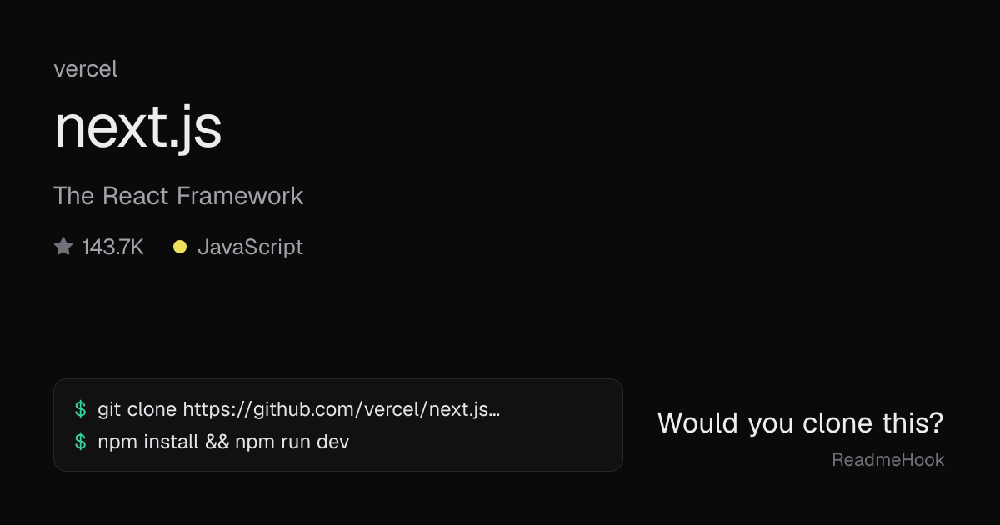
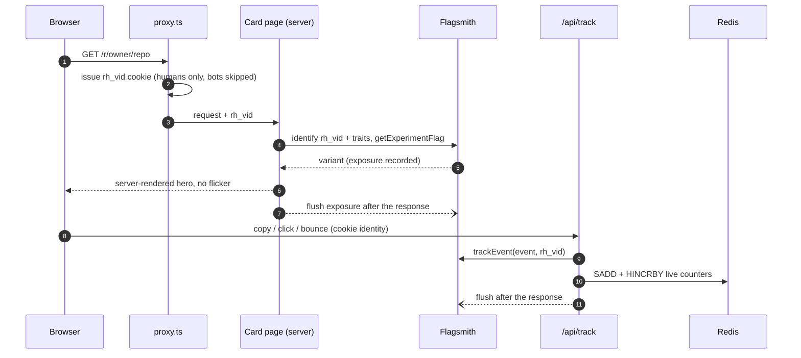
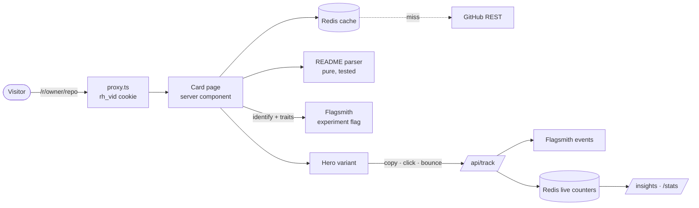

<div align="center">

# ReadmeHook

**Would a developer clone your repo in 5 seconds?**

Paste a public GitHub repo. Get a shareable landing card.<br/>
A live A/B test on that card finds the hero that makes developers copy the clone command.

[](https://nextjs.org)
[](https://www.typescriptlang.org)
[](https://docs.flagsmith.com/experimentation)
[](https://upstash.com)
[](https://vercel.com)
[](https://vitest.dev)

[Live demo](https://readmehook.vercel.app) · [Insights](https://readmehook.vercel.app/insights) · [Results](docs/results.md) · [Experiment plan](docs/experiment-plan.md) · [How it works](#how-it-works) · [Run it](#run-it-locally)

<br/>



<sub>The unfurl image ReadmeHook renders for <code>vercel/next.js</code>, straight from <code>/api/og/vercel/next.js</code></sub>

</div>

<br/>

Built for **Toggle Wars, the Flagsmith Experimentation Hackathon** (WeMakeDevs) · Track 01 *Test Something Real*.

<a id="live"></a>

> **Live:** [readmehook.vercel.app](https://readmehook.vercel.app) · **Try it:** [vercel/next.js card](https://readmehook.vercel.app/r/vercel/next.js) · **Dashboard:** [/insights](https://readmehook.vercel.app/insights) · **Source of truth:** the Flagsmith results page linked from the dashboard

<!-- Update daily: date, status from Flagsmith, n per arm from Flagsmith, one plain sentence. No leader below 30 per arm. -->
**Experiment status** (updated __): __ · n = __ vs __ (Flagsmith) · __

---

## The question

Developers decide whether to star, clone or leave a repo within seconds of landing on it. Hackathon READMEs often lose that window: a wall of text, a buried pitch, a quickstart halfway down the page.

So we tested one concrete thing on real visitors:

> **Hypothesis.** If a visitor sees a copyable quickstart command above the fold (`quickstart_first`) instead of an architecture diagram (`architecture_first`), they are more likely to show developer intent (copy the clone command or click through to GitHub), because the first question a developer asks in 5 seconds is *"can I run this?"*. We expect a higher Developer Intent Rate with no increase in sub-5-second bounces.

Written down before the experiment started, together with the sample-size estimate and the decision rule, in [`docs/experiment-plan.md`](docs/experiment-plan.md).

## The experiment

<table>
<tr>
<td width="50%" valign="top">

**Control: `architecture_first`**

The README's Mermaid diagram (or a generated one) above the fold.

</td>
<td width="50%" valign="top">

**Treatment: `quickstart_first`**

A copyable, highlighted quickstart command above the fold.

</td>
</tr>
</table>

<!-- When captured, show both heroes side by side:

-->

| | |
|---|---|
| **Flag** | `repo_hero_layout` (multivariate) · 50/50 · `demo_gif_first` ready at 0% for the next test |
| **Unit** | anonymous visitor: one `rh_vid` cookie, which is also the Flagsmith identity and the Redis uniqueness key |
| **Primary metric** | `developer_intent`: a visitor's first clone-command copy or GitHub click on a repo |
| **Secondary** | `clone_command_copied` · `github_outbound_click` |
| **Guardrail** | `bounce_under_5s`: tab hidden or closed within 5 s with no conversion (should not increase) |
| **Fairness** | only the hero block differs. Name, stars, clone box and GitHub button are identical in both arms |

### Why the numbers can be trusted



- **The server decides the variant.** The visitor is identified with traits (`repo_language`, `has_demo_video`, `has_mermaid_diagram`, `referrer_source`) and `getExperimentFlag` records the exposure in the same call. The browser never re-evaluates.
- **Only real visitors become exposures.** Bots, link unfurlers (Discord, Slack, Twitter), prefetches and the creator's own first view are never identified.
- **Events can't be spoofed into the wrong identity.** `/api/track` reads the identity from an httpOnly cookie, never from the body, accepts only allow-listed event names, and rate-limits each visitor to 60 events a minute.
- **Nothing is dropped on serverless.** Every exposure and event is flushed with `after()`, which Vercel keeps alive after the response is sent.
- **Simulated traffic never reaches Production.** The simulator refuses to run unless the target server is local, on the Development key and under the `sim:` prefix.

## Results

| | |
|---|---|
| **Status** | running in Production since 2026-11-25 (Flagsmith experiment 485) |
| **Write-up** | [`docs/results.md`](docs/results.md): n per arm, intent and bounce rates, what Flagsmith's results page shows, and the decision per the plan |
| **Rule** | we only claim what the Flagsmith results page supports. With a hackathon-sized sample, an inconclusive result is a valid result |

<!-- When captured:


-->

## What it does

| | |
|---|---|
| **Landing card** · `/r/owner/repo` | Name, description, stars, language, a one-click clone command and the experiment's hero block |
| **Share panel** | Right after you paste a repo: your link, a ready Discord message with `?ref=discord`, and the way to the audit. Your own view isn't counted |
| **Unfurl image** · `/api/og/owner/repo` | A 1200×630 card with the quickstart and *"Would you clone this?"* for Discord and Twitter |
| **README audit** · `/r/owner/repo/stats` | Checks for a quickstart in the first 30 lines, a Mermaid diagram and a demo GIF, each with a paste-ready fix, plus *Copy optimized README hero*. Live A/B results for the repo once it has 10+ visitors |
| **Insights** · `/insights` | n per arm, intent and bounce rates, guardrail status (Baseline · OK · Watch · Breach), language breakdown, and an admin drawer for the `visual_heavy_repos` segment override |

<!-- When captured:
 
-->

## How it works



**Stack:** Next.js 16 (App Router, Cache Components) · TypeScript strict · Tailwind CSS · `@flagsmith/nodejs` 9 · Upstash Redis · `next/og` · Mermaid · Shiki · Vitest · Vercel. Details in [`docs/architecture.md`](docs/architecture.md).

## Run it locally

You need Node 22+, pnpm, a Flagsmith project with Development and Production environments, a GitHub fine-grained token (public repos, read-only) and an Upstash Redis database.

```bash
pnpm install
cp .env.example .env.local   # Development server key, GitHub token, Upstash credentials
pnpm dev                     # http://localhost:3000
```

```bash
pnpm lint && pnpm typecheck && pnpm test   # runs before every commit
```

<details>
<summary><b>Simulate traffic</b> (Development only)</summary>

<br/>

```bash
TELEMETRY_PREFIX=sim: FLAGSMITH_ENV_NAME=development pnpm dev        # terminal 1
TELEMETRY_PREFIX=sim: FLAGSMITH_ENV_NAME=development pnpm simulate -- --visitors 200 --rate 5   # terminal 2
```

Refuses to run against Production or any server not running under `sim:`. Simulated numbers are pipeline checks, never results. See [`scripts/README.md`](scripts/README.md).

</details>

<details>
<summary><b>Flagsmith setup</b></summary>

<br/>

Flag, variations, metrics and experiment, with the exact values and ids: [`docs/flagsmith-setup.md`](docs/flagsmith-setup.md).

</details>

<details>
<summary><b>Deploy to Vercel</b></summary>

<br/>

Environment variables, deploy steps and the launch checklist: [`docs/deploy-vercel.md`](docs/deploy-vercel.md).

```bash
vercel env add FLAGSMITH_SERVER_KEY --environment production
vercel deploy --prod
```

</details>

<details>
<summary><b>Repository map</b></summary>

<br/>

| Path | What |
|---|---|
| `app/` | routes: `/`, `/r/[owner]/[repo]`, `/stats`, `/insights`, `/api/track`, `/api/og` |
| `components/hero/` | the shared shell and the three hero variants |
| `components/telemetry/` | copy button, GitHub button, card-view and bounce trackers |
| `lib/flagsmith/` | SDK client, `evaluateHeroLayout`, event tracking, flush |
| `lib/telemetry/` | event-name contract, request schema, dual-write, counters |
| `lib/parser/` | pure README parser: quickstart, Mermaid, demo media |
| `lib/advice/` | audit, README hero export, Stage 2 verdict |
| `scripts/` | Development-only traffic simulator |
| `docs/` | experiment plan, results, Flagsmith setup, deploy guide |

</details>

## Privacy

Visitors are anonymous: one random id in an httpOnly cookie. No accounts, no IP addresses stored, no LLM calls.

<div align="center">
<br/>
<sub>Made for Toggle Wars · Flagsmith Experimentation Hackathon</sub>
</div>
