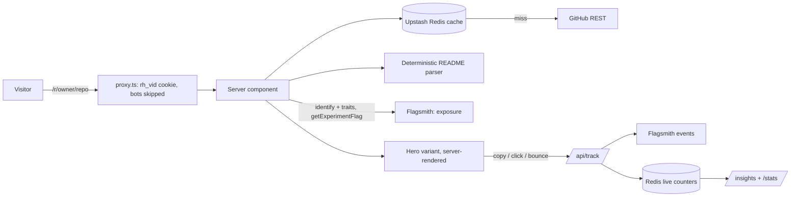

# ReadmeHook

**Would a developer clone your repo in 5 seconds?** Paste a public GitHub repo and ReadmeHook turns it into a shareable landing card. A live **Flagsmith Experimentation** A/B test runs on the card to find out which above-the-fold hero gets developers to copy the clone command or click through to GitHub.

Built for **Toggle Wars, the Flagsmith Experimentation Hackathon** (WeMakeDevs), Track 01 "Test Something Real".

- Live: `<add the Amplify URL>`
- Experiment dashboard: `<live URL>/insights` (source of truth: the Flagsmith results page linked from there)
- Results write-up: [`docs/results.md`](docs/results.md)

> Screenshot: `docs/screenshots/card-variants.png`, the two heroes side by side

## Why

Developers decide whether to star, clone or leave a repo within seconds of landing on it. Hackathon READMEs often lose that window: walls of text, a buried value proposition, a quickstart halfway down the page. We wanted a real answer to one concrete question, measured on real visitors: **does a copyable quickstart above the fold beat an architecture diagram?**

## Hypothesis

> If a visitor sees a copyable quickstart command above the fold (`quickstart_first`) instead of an architecture diagram (`architecture_first`), they are more likely to show developer intent (copy the clone command or click through to GitHub), because the first question a developer asks in 5 seconds is "can I run this?". We expect a higher Developer Intent Rate with no increase in sub-5-second bounces.

Written down before the experiment started. Design, sample-size estimates and decision rule: [`docs/experiment-plan.md`](docs/experiment-plan.md).

## The experiment

| | |
|---|---|
| Flag | `repo_hero_layout` (multivariate): `architecture_first` (control) vs `quickstart_first`, 50/50. `demo_gif_first` exists at 0% for the next test |
| Unit | anonymous visitor: an `rh_vid` cookie, which is also the Flagsmith identity and the Redis uniqueness key |
| Primary metric | `developer_intent`: first clone-command copy or GitHub click per visitor per repo |
| Secondary | `clone_command_copied`, `github_outbound_click` |
| Guardrail | `bounce_under_5s`: tab hidden or closed within 5 s with no conversion (should not increase) |
| Fairness | only the hero block differs; name, stars, clone box and GitHub button are identical in every arm |

**How exposures and events stay correct**
- The variant is decided **on the server**: the visitor is identified with traits (`repo_language`, `has_demo_video`, `has_mermaid_diagram`, `referrer_source`), then `getExperimentFlag` evaluates the flag and records the exposure in the same call. The variant goes to the client as a prop, so there is no flicker and the browser never re-evaluates.
- Bots, link unfurlers (Discord, Slack, Twitter), browser prefetches and the creator's own first view are never identified, so they never become exposures.
- Conversions go through `POST /api/track`. The identity comes from the httpOnly cookie, never from the request body. Event names are on an allow-list, and each visitor is limited to 60 events a minute. Every event is written to Flagsmith **and** to Redis live counters.
- On serverless the Flagsmith event buffer is flushed **before** each response, so a frozen Lambda can't drop exposures.
- Simulated traffic can only reach a local Development server and is kept under a separate Redis prefix. It never touches Production.

## Results

The experiment runs in Production from 2026-11-25. **Results: [`docs/results.md`](docs/results.md)** (n per arm, intent and bounce rates, what Flagsmith's results page shows, and the decision per the plan). We report only what the Flagsmith results page supports; with a hackathon-sized sample, an inconclusive result is a valid result.

> Screenshot: `docs/screenshots/flagsmith-results.png`, the Flagsmith results page
>
> Screenshot: `docs/screenshots/insights.png`, `/insights` live counters

## What else it does

- **Creator flow:** paste a repo URL and land on the card with a share panel: the link, a ready-made Discord message with `?ref=discord`, and the way to the README audit.
- **Unfurls:** a dynamic Open Graph image (`/api/og/owner/repo`) with name, stars, language and the quickstart.
- **README audit** (`/r/owner/repo/stats`): checks for a quickstart in the first 30 lines, a Mermaid diagram and a demo GIF or video, each with a paste-ready fix, plus a one-click "Copy optimized README hero". Once a card has 10+ visitors it also shows live A/B results for that repo.
- **`/insights`:** n per arm, intent and bounce rates, guardrail status (Baseline / OK / Watch / Breach), a language breakdown, and an admin-only drawer explaining the `visual_heavy_repos` segment override (`has_demo_video == true` → `demo_gif_first`).

> Screenshots: `docs/screenshots/share-panel.png`, `docs/screenshots/stats-audit.png`, `docs/screenshots/og-image.png`

## How it works



Stack: Next.js 16 (App Router) · TypeScript (strict) · Tailwind CSS · `@flagsmith/nodejs` 9 · Upstash Redis · `next/og` · Mermaid · Shiki · Vitest · AWS Amplify Hosting. More: [`docs/architecture.md`](docs/architecture.md).

## Run it locally

Prerequisites: Node 22+, pnpm, a Flagsmith project (Development + Production environments), a GitHub fine-grained PAT (public repos, read-only) and an Upstash Redis database.

```bash
pnpm install
cp .env.example .env.local      # fill in the Development server key, GitHub token, Upstash
pnpm dev                        # http://localhost:3000
```

Checks (run before every commit, and in the Amplify build):

```bash
pnpm lint && pnpm typecheck && pnpm test
```

Simulated traffic (Development only, refuses anything else):

```bash
TELEMETRY_PREFIX=sim: FLAGSMITH_ENV_NAME=development pnpm dev        # terminal 1
TELEMETRY_PREFIX=sim: FLAGSMITH_ENV_NAME=development pnpm simulate -- --visitors 200 --rate 5   # terminal 2
```

Flagsmith flag, metrics and experiment setup: [`docs/flagsmith-setup.md`](docs/flagsmith-setup.md). Deploying: [`docs/deploy-amplify.md`](docs/deploy-amplify.md).

## Repository map

| Path | What |
|---|---|
| `app/` | routes: `/`, `/r/[owner]/[repo]`, `/stats`, `/insights`, `/api/track`, `/api/og` |
| `components/hero/` | the shared shell and the three hero variants |
| `components/telemetry/` | copy button, GitHub button, card view and bounce trackers |
| `lib/flagsmith/` | SDK client, `evaluateHeroLayout`, event tracking, flush |
| `lib/telemetry/` | event-name contract, request schema, dual-write, counters |
| `lib/parser/` | pure README parser (quickstart, Mermaid, demo media) |
| `lib/advice/` | audit, README hero export, Stage 2 verdict |
| `scripts/simulate-traffic.ts` | Development-only traffic simulator |
| `docs/` | PRD-level docs, experiment plan, results, setup and deploy guides |

## Privacy

Visitors are anonymous: one random id in an httpOnly cookie. No accounts, no IP addresses stored, no LLM calls.
