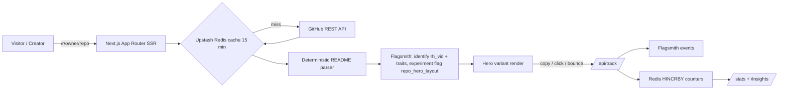

# Architecture

## Request flow for `/r/[owner]/[repo]`

1. `middleware.ts` ensures `rh_vid` cookie; marks bots.
2. Server component loads `getRepoSnapshot(owner, repo)` (cache → GitHub).
3. `parseReadme(snapshot)` → `ParsedReadme` (pure).
4. If human: `evaluateHeroLayout(rh_vid, traits)` → variant (exposure recorded). If bot: control, no identify.
5. Render `HeroShell` + variant hero; client components attach trackers.
6. Client fires `card_view` on mount.

## Telemetry flow

Client `trackExperimentEvent` → `POST /api/track` (`sendBeacon` for unload/outbound) → validate → Flagsmith event (identity `rh_vid`) + Redis counters → flush after response.

## Redis keys

| Key | Type | Purpose |
|---|---|---|
| `gh:{owner}/{repo}` | string JSON, 900 s | RepoSnapshot cache |
| `gh:stale:{owner}/{repo}` | string JSON, 24 h | stale fallback |
| `{p}repo:{owner}/{repo}:variant:{v}` | hash | `views, clones, outbound, intent, bounces` |
| `{p}repo:{owner}/{repo}:variant:{v}:uniq:{metric}` | set | visitor ids already counted |
| `{p}exp:variant:{v}` | hash | global totals |
| `{p}exp:lang:{lang}:variant:{v}` | hash | language breakdown |
| `{p}rl:{vid}` | counter, 60 s | rate limit |

`{p}` = `TELEMETRY_PREFIX` (`""` prod, `sim:` simulation).

## Source of truth

Flagsmith's experiment results page is the source of truth for the verdict. Redis counters power per-repo creator pages and the live dashboard and are labelled "live counters".
