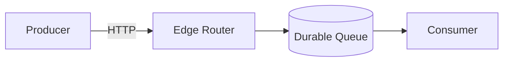

<p align="center">
  
</p>

# Relay

[](https://github.com/acme/relay/actions)
[](https://www.npmjs.com/package/@acme/relay)

Relay is a tiny event bus for edge functions. Publish from anywhere, subscribe from anywhere.

## Architecture



## Quickstart

```bash
npx create-relay-app my-app
cd my-app
npm run dev
```

## Usage

```ts
import { relay } from '@acme/relay';

await relay.publish('orders.created', { id: 42 });
```

## License

MIT
